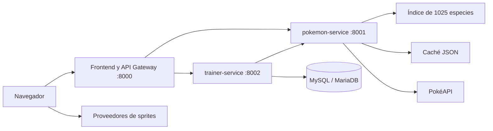
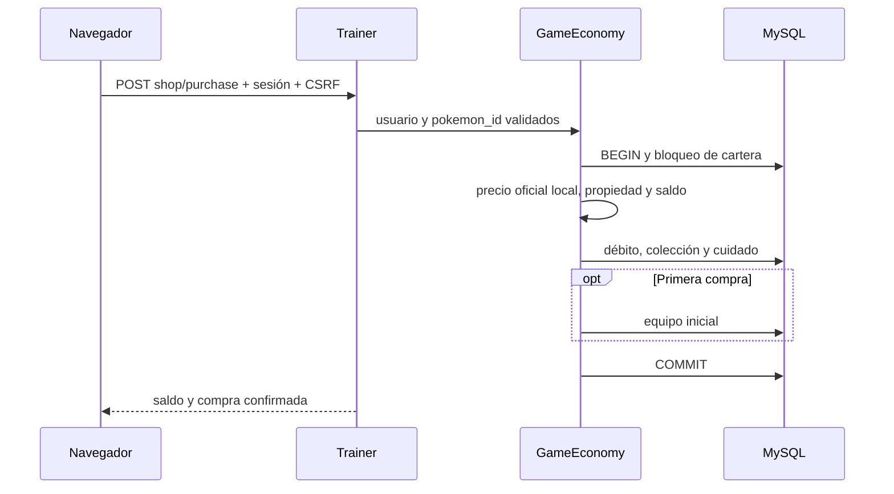
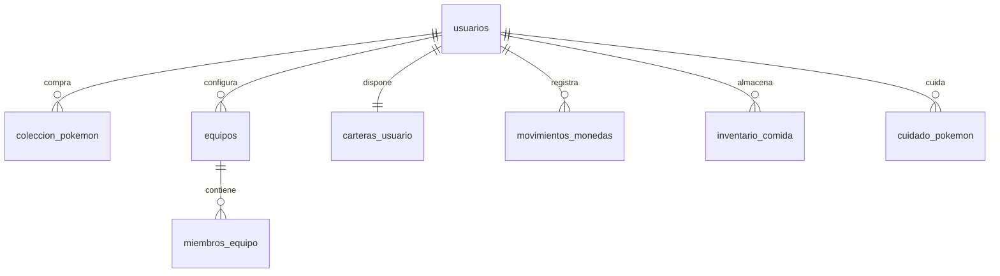

# Arquitectura y organización

## Vista general

La interfaz PHP/HTML se sirve desde Apache o desde el puerto 8000. El navegador usa el API Gateway del frontend para consultar los dos microservicios en el mismo origen.

El Catálogo, el Hogar y la preparación de batalla usan los datos de especies que `pokemon-service` publica por HTTP. El índice de especies vive en el servicio de Pokémon y se genera a partir de PokéAPI. El servicio de entrenadores aplica precios, progresión y reglas de juego. Al detener el puerto 8001, su API deja de suministrar fichas y rutas de imágenes. El puerto 8002 puede seguir atendiendo el inicio de sesión y las consultas de saldo.

## API Gateway y seguridad

`/api/pokemon/` dirige las consultas de Pokémon al puerto 8001 y `/api/entrenadores/` dirige cuentas y acciones del juego al puerto 8002. En modo LAN solo se publica el puerto 8000.

El servicio de entrenadores emite un JWT firmado con HS256 cuando termina el inicio de sesión, incluido el segundo factor si está activo. La cookie es `HttpOnly` y `SameSite=Lax`. El gateway valida la firma, la expiración y el vínculo con la sesión PHP. El servicio confirma que la sesión siga activa y verifica el token CSRF en operaciones protegidas de escritura. El JWT vence a las ocho horas como máximo y cerrar sesión invalida la sesión asociada.

El acceso con Google usa el flujo OAuth 2.0 de código de autorización con `state` de un solo uso y PKCE. Entrenadores consulta el perfil verificado en UserInfo. En el primer registro el jugador elige un usuario, y PokéMarket guarda el identificador de Google para próximos accesos. Las cuentas anteriores con ese correo pasan por su verificación local y las cuentas vinculadas conservan el autenticador si está activado.

## Responsabilidades

| Componente                                           | Responsabilidad                                                            |
| ---------------------------------------------------- | -------------------------------------------------------------------------- |
| `frontend/partials/`                                          | Evitar duplicar la navegación y los componentes compartidos                |
| `frontend/assets/js/api.js`                                   | Peticiones, sesión, token CSRF y carga progresiva de imágenes              |
| `market.js`, `home.js`, `batalla.js`, `equipos.js`   | Interacción de cada pantalla                                               |
| `backend/trainer-service/public/index.php`                   | Componer dependencias, aplicar controles HTTP y manejar fallos inesperados |
| `backend/trainer-service/src/rutas.php`                      | Despachar método y ruta                                                    |
| Controladores                                        | Validar la entrada y coordinar una operación de aplicación                 |
| `GameEconomy`                                        | Compras, regalo, saldo, inventario, cuidado y liquidación de premios       |
| `MarketCatalog`                                      | Categorías, precio y metadatos del catálogo completo                       |
| `BattleRules`                                        | Reglas puras de daño, efectividad y selección de reservas                  |
| `SessionManager`                                     | Identidad, cookie, expiración y token CSRF                                 |
| `Input`                                              | Validación reutilizable de texto                                           |
| `PokemonController`, `PokeApiClient`, `CacheService` | Adaptación de datos externos y caché                                       |

Los controladores reciben sus dependencias mediante constructor. El de batalla ya no abre una segunda conexión de base de datos ni crea un cliente HTTP que no utiliza. Las reglas puras no dependen de HTTP ni de PDO; se prueban directamente.

## Eventos de amistad e invitaciones a sala

`trainer-service` registra una solicitud de amistad y el evento `amistad_solicitada` en la misma transacción. El consumidor marca el evento como entregado y el destinatario ve la solicitud en Amigos. Aceptarla quita el aviso y agrega al entrenador a la lista. Rechazarla elimina la solicitud y permite generar un evento nuevo al reenviarla.

`trainer-service` guarda la sala, sus integrantes y un evento `invitacion_creada` por invitado en la misma transacción. Un proceso PHP independiente consume `eventos_sala`, registra el aviso en `notificaciones_sala` y marca el evento como procesado en una transacción. La clave del evento evita avisos duplicados. Las invitaciones vencidas, aceptadas o canceladas antes de procesarse se descartan. El navegador consulta los avisos entregados y abre la sala cuando el jugador pulsa la invitación.

## Compra: flujo y garantía

El navegador no decide el precio. Ante una excepción se revierte la transacción. Los movimientos únicos evitan duplicar regalo, compra y premio de una batalla. Comida, cuidado y compras se serializan por cartera.

## Datos

Colección y cuidado se relacionan por usuario y especie en las operaciones del servicio. La validación de pertenencia de un miembro de equipo se realiza en el servidor. El esquema nuevo añade claves foráneas hacia usuarios y equipos; las instalaciones históricas pueden conservar restricciones anteriores y no se modifican destructivamente.

Las batallas activas se guardan en la sesión PHP, mientras que saldo y premios están en MySQL. Esta decisión permite un despliegue local sencillo, pero una sesión perdida puede hacer perder una partida en curso. No es una arquitectura de alta disponibilidad ni un combate multijugador distribuido.

## Decisiones de mantenimiento

- Se conservaron las URL de las páginas para no romper navegación ni enlaces guardados.
- Se retiraron las rutas monolíticas `api/`, el cliente HTTP de trainer sin uso y los scripts de colección anteriores.
- Los datos oficiales compilados se versionan; los CSV crudos descargados, cachés y respaldos no.
- Los documentos del juego se movieron a `docs/game/`; la raíz ofrece una única entrada documental: `README.md`.
- Node y Prettier se usan para desarrollo, no para ejecutar el juego.
- La configuración externa evita editar código para cambiar la conexión a MySQL.

## Persistencia de aventuras

`AdventureRules` concentra precios de escenarios, niveles de dificultad y fórmula de retorno; no conoce HTTP. `WagerService` coordina ofertas temporales, reserva de entrada y guardado de partidas en transacciones PDO. Siempre bloquea primero la cartera y después la ronda para mantener el mismo orden de bloqueos.

`rondas_apuesta` guarda estado, versión y snapshot JSON. Los turnos leen esa fuente persistente, no una copia antigua de sesión. El guardado compara versiones y rechaza cambios concurrentes. Una apuesta pendiente impide iniciar otro combate. Las batallas ordinarias mantienen su mecanismo de sesión existente.

`welcome.js`, `wager-ui.js` y `home-music.js` separan el recorrido inicial, la selección y confirmación de apuestas y la reproducción de audio de los controladores de pantalla.
